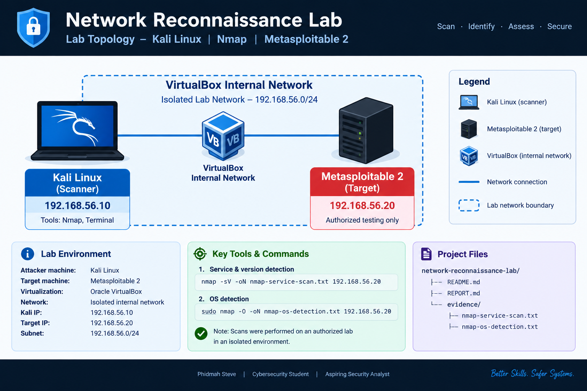

# Network Reconnaissance & Security Assessment Lab

**A hands-on cybersecurity project using Kali Linux, Nmap, and Metasploitable 2.**


## Overview

This project documents an authorized network reconnaissance exercise conducted in an isolated VirtualBox lab. Nmap was used to identify open TCP ports, detect service versions, and attempt operating-system fingerprinting against a Metasploitable 2 target.

The project demonstrates foundational skills in network scanning, service enumeration, evidence collection, risk identification, and security reporting.


## Lab Network Topology

The diagram below illustrates the isolated VirtualBox lab used
for authorized network reconnaissance.




## Objectives

- Identify an active target on an isolated lab network.
- Discover open TCP ports and attempt service-version detection.
- Attempt operating-system detection using Nmap.
- Document findings and potential security risks.
- Recommend defensive measures based on the observations.

## Lab Environment

| Component | Configuration |
|---|---|
| Attacker machine | Kali Linux |
| Target machine | Metasploitable 2 |
| Virtualization | Oracle VirtualBox |
| Scanning tool | Nmap |
| Kali lab IP | `192.168.56.10` |
| Target lab IP | `192.168.56.20` |
| Network | Isolated VirtualBox internal network |

## Methodology

### 1. Service and version detection

Command used:

```bash
nmap -sV -oN nmap-service-scan.txt 192.168.56.20
```

This scan checked the 1,000 most common TCP ports by default and attempted to identify services and their versions.

### 2. Operating-system detection

Command used:

```bash
sudo nmap -O -oN nmap-os-detection.txt 192.168.56.20
```

Nmap attempted to fingerprint the target operating system. The result did not provide an exact OS match, so the precise operating-system identification remains inconclusive.

## Key Findings

The service scan identified **23 open TCP ports among the 1,000 most common TCP ports scanned**.

Examples of detected services included:

| Port | Service | Reported version or detail |
|---|---|---|
| 21 | FTP | vsftpd 2.3.4 |
| 22 | SSH | OpenSSH 4.7p1 |
| 23 | Telnet | Linux telnetd |
| 25 | SMTP | Postfix smtpd |
| 53 | DNS | ISC BIND 9.4.2 |
| 80 | HTTP | Apache 2.2.8 |
| 139, 445 | SMB | Samba 3.X–4.X |
| 3306 | MySQL | 5.0.51a |
| 5432 | PostgreSQL | 8.3.0–8.3.7 |
| 5900 | VNC | Protocol 3.3 |

*Note: Versions are reported by Nmap and have not been independently verified. Service detection alone does not prove that a vulnerability is present or exploitable.*

## Potential Security Risks

- **Legacy software:** Older versions may contain known security vulnerabilities.
- **Insecure protocols:** Telnet and certain FTP configurations may transmit credentials or data without adequate encryption.
- **Exposed services:** Unnecessary open ports increase the attack surface.
- **Database access:** MySQL and PostgreSQL should be restricted to authorized systems.
- **File sharing and remote access:** SMB, RPC, and remote administration services require careful configuration and access control.

These are potential risks requiring further validation, not confirmed successful exploits.

## Recommendations

1. Upgrade unsupported software and operating systems to maintained versions.
2. Disable unnecessary services and close unused ports.
3. Replace Telnet with SSH and use secure file-transfer protocols.
4. Restrict database access using firewalls and least-privilege permissions.
5. Apply security patches and review service configurations.
6. Monitor authentication logs and suspicious network activity.
7. Rescan after remediation to assess whether the exposed attack surface has decreased.

## Project Structure

```text
network-reconnaissance-lab/
├── README.md
├── REPORT.md
└── evidence/
    ├── nmap-service-scan.txt
    └── nmap-os-detection.txt
```

- **README.md:** Project overview, methodology, key findings, and recommendations.
- **REPORT.md:** Detailed security assessment report.
- **evidence/:** Saved Nmap scan outputs.

## Limitations

This assessment used Nmap service detection and OS fingerprinting. It did not establish exploitability or independently verify every detected version. The OS fingerprinting result was inconclusive, and the service scan covered the default 1,000 most common TCP ports rather than all 65,535 TCP ports.

## Ethical Considerations

All scanning was performed against a deliberately vulnerable target in an isolated, authorized lab environment. Only systems for which explicit authorization has been granted should be scanned.

## Skills Demonstrated

- Network reconnaissance
- TCP port scanning
- Service-version detection
- Basic OS fingerprinting
- Security risk identification
- Technical documentation
- Evidence-based reporting
- Defensive security recommendations

## Author

**Phidmah Steve**  
Cybersecurity student | Aspiring Security Analyst

GitHub: [@Phidmah-Steve](https://github.com/Phidmah-Steve)

---

*This project is part of my ongoing practical cybersecurity learning portfolio.*
